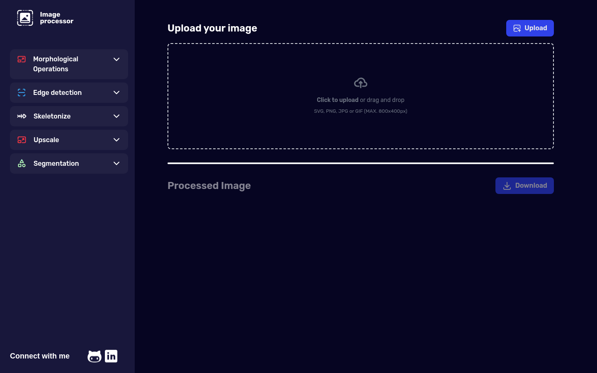
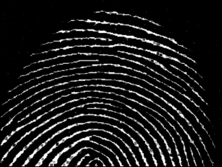
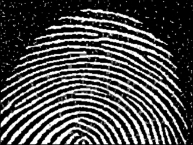
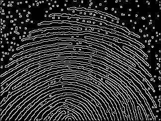
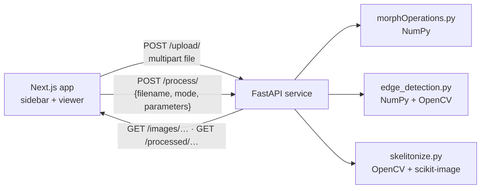

<div align="center">

# Image Processor

**A web app for classic image processing — morphological operations, Canny-style edge detection and skeletonization — with the core algorithms written by hand in NumPy behind a FastAPI service.**




[Live demo](https://image-processing-webapp.vercel.app) · [API reference](#api) · [Run it locally](#getting-started)

</div>

---

## Overview

Upload an image, pick a processing mode in the sidebar, tune its parameters, and download the result. The front end is a Next.js single-page app; the back end is a small FastAPI service that stores the upload, runs the selected pipeline and serves the output.

The point of the project is the processing code itself. Erosion, dilation, opening and closing are implemented directly on NumPy arrays rather than delegated to a library call, and the edge detector is a Canny pipeline assembled stage by stage — blur, gradients, non-maximum suppression, double threshold, hysteresis.

## Highlights

- **Morphology from scratch** — erosion and dilation as min/max filters over a structuring element, with opening and closing composed from them. Rectangular, elliptical and cross kernels of any size.
- **Hand-built Canny edge detector** — Gaussian blur → Sobel gradients → non-maximum suppression → double thresholding → edge tracking by hysteresis, with every stage's parameter exposed.
- **Skeletonization** — binary threshold, noise clean-up with opening and closing, then thinning to one-pixel-wide lines.
- **Upload feedback** — instant local preview, a live percentage bar while the file is in flight, and a clear error state if it fails.
- **One-click download** of the processed image.

## Results

The same noisy fingerprint through each operation — 3×3 rectangular kernel, one iteration; edge detection at its default settings.

<table>
  <tr>
    <td width="33%"></td>
    <td width="33%"></td>
    <td width="33%"></td>
  </tr>
  <tr>
    <td align="center"><sub>Original</sub></td>
    <td align="center"><sub>Erosion — background specks removed, ridges thinned</sub></td>
    <td align="center"><sub>Dilation — ridges thickened, gaps filled</sub></td>
  </tr>
  <tr>
    <td></td>
    <td></td>
    <td></td>
  </tr>
  <tr>
    <td align="center"><sub>Opening — erosion, then dilation</sub></td>
    <td align="center"><sub>Closing — dilation, then erosion</sub></td>
    <td align="center"><sub>Edge detection</sub></td>
  </tr>
</table>

## Processing modes

| Mode | Pipeline | Parameters (API default) |
|---|---|---|
| **Morphological operations** | Grayscale → erosion, dilation, opening or closing | `morph_op`, `kernel_size` (5), `kernel_shape` (`rect`, `ellipse`, `cross`), `iterations` (1) |
| **Edge detection** | Grayscale → Gaussian blur → Sobel → non-maximum suppression → double threshold → hysteresis | `kernel_size` (5), `sigma` (1.0), `low_threshold` (20), `high_threshold` (40) |
| **Skeletonize** | Grayscale → binary threshold → invert → 9×9 opening and closing → skeleton | `threshold` (128) |

Skeletonize expects dark shapes on a light background, and suits bold shapes better than fine textures. Upscale and Segmentation appear in the sidebar but are not available yet.

## Architecture



| Part | Stack | Role |
|---|---|---|
| Front end (`front/`) | Next.js 14 (App Router), React 18, Tailwind CSS, Zustand | Upload, mode and parameter selection, original and processed views, download |
| Back end (`backend/`) | FastAPI, NumPy, OpenCV, scikit-image, Pillow | Stores uploads, runs the processing pipelines, serves the results |

## API

| Method | Endpoint | Purpose |
|---|---|---|
| `POST` | `/upload/` | Upload an image as multipart form data (field `file`). Returns `{"filename": "<uuid>.jpg"}` |
| `POST` | `/process/` | Process an uploaded image. Returns `{"processed_filename": "..."}` |
| `GET` | `/images/{filename}` | Fetch an uploaded image |
| `GET` | `/processed/{filename}` | Fetch a processed image |

`mode` is `MorphOp`, `Edge` or `Skeletonize`; only the parameters of the chosen mode are read.

```json
{
  "filename": "ae00c3fd-4874-46cd-ad56-b5c6cd4e05e9.jpg",
  "mode": "MorphOp",
  "morph_op": "opening",
  "kernel_size": 3,
  "kernel_shape": "rect",
  "iterations": 1
}
```

FastAPI also serves interactive documentation at `/docs`.

## Repository layout

```
├── backend/
│   ├── main.py               # FastAPI app: upload, process and file-serving routes, CORS
│   ├── morphOperations.py    # Structuring elements, erosion, dilation, opening, closing
│   ├── edge_detection.py     # Canny-style edge detection pipeline
│   ├── skelitonize.py        # Threshold, clean-up and skeletonization
│   ├── requirements.txt
│   └── vercel.json           # Vercel Python runtime configuration
├── front/
│   └── src/
│       ├── app/              # Layout and the main page (upload, preview, download)
│       ├── components/       # Sidebar: modes, parameters and the process action
│       └── store/            # Zustand stores: mode, image, morph settings, result
└── docs/images/              # Screenshot and sample results used in this README
```

## Getting started

**Requirements:** Python 3.12 and Node.js (the front end pins `26.x` in `package.json`).

1. **Back end**
   ```bash
   cd backend
   python -m venv .venv
   source .venv/bin/activate        # Windows: .venv\Scripts\activate
   pip install -r requirements.txt
   uvicorn main:app --reload        # http://localhost:8000
   ```
2. **Front end**
   ```bash
   cd front
   npm install
   echo "NEXT_PUBLIC_API_URL=http://localhost:8000" > .env.local
   npm run dev                      # http://localhost:3000
   ```

`NEXT_PUBLIC_API_URL` sets where uploads go. The process requests in `front/src/components/Sidebar.jsx` still point at the hosted API, so change those URLs too when running against a local back end.

## Roadmap

- Upscaling (×2 and ×4) and segmentation, already stubbed in the sidebar
- An iterations control for morphological operations in the UI (the API already accepts it)
- Vectorized morphology, to keep large images fast

## Author

**Mohamed Baarar** — [@eddev00](https://github.com/eddev00) · [LinkedIn](https://www.linkedin.com/in/mohamed-baarar/)

Released under the [MIT License](LICENSE).
